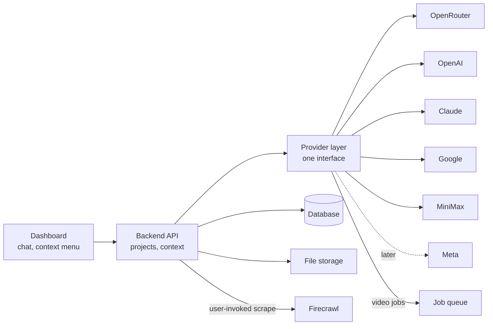

# Content Hub: Plan

2026-09-30 · Henry

## Goal

Content Hub is a web dashboard where a user creates a project, brings in context (text, images, video), and generates new text, image and video content from it using third-party AI APIs. One place instead of juggling separate tools.

## Core concept: workspaces, context, projects and chats

The user controls what context a chat sees:

- **Workspace:** the top-level boundary. Context, projects, chats and settings belong to a workspace and stay separate from other workspaces. A workspace can have several members, all with the same role for now.
- **Context library:** a menu in the dashboard where the user adds context items (text, images, video), such as brand notes or reference assets. Items are reusable across the workspace's projects.
- **Project:** a space inside a workspace. It includes the context items the user picks from the library, and can override the default system prompt with its own instructions.
- **Chat:** every conversation is separate, and there are two kinds:
    - **Free chat:** starts with zero context. It is saved in the workspace history and can be moved into a project later, where it picks up the project's context and instructions.
    - **Project chat:** starts from a project, and its context is filled automatically from the project's context and instructions.
- **One-off attachments:** in either kind of chat, the user can attach files for that chat only. They are not saved to the library.
- **Outputs:** finished text, image or video generated in a chat, saved in the workspace. The user can choose to add an output to the context library so it can be included later.

Conversations are never saved as context on their own. The user decides what becomes context. That control is the main value over a plain chat window.

## Settings and overrides

A settings page holds the defaults for the workspace, so all members share them. Each default can be overridden lower down, and the most specific setting wins: chat over project over settings.

| Setting             | Default set in | Override in        |
| ------------------- | -------------- | ------------------ |
| System prompt       | Settings       | Project, then chat |
| Text model          | Settings       | Chat               |
| Image model         | Settings       | Chat               |
| Video model         | Settings       | Chat               |
| Media reading model | Settings       | Chat               |

- A project or chat system prompt can either add to the default or replace it. Adding is the default: the prompts are joined in order (settings, project, chat).
- The prompt that makes the agent pick a workflow stays in code on the server. Users do not edit it.
- Model choice comes from the models the provider layer exposes. OpenRouter is the default source.

## Model capabilities

Models differ in what they can read and produce, so the app checks capability before sending anything. Each model carries its input types (text, image, video), its output type and its context window, taken from the provider's model list (verify which fields OpenRouter exposes when building). The media reading model in settings is the model used to describe images and video for models that cannot read them.

- **Picker:** the text, image and video settings only list models that can produce that output. A model that cannot read what the chat holds is marked with a warning.
- **Check before sending:** the app compares the chat's context and attachments with the chosen model's input types. A text-only model cannot read images or video. Some image and video models take only text, and others also accept a reference image.
- **On a mismatch, convert by default:** the media reading model describes each image, or samples frames from a video and describes them, and the text goes to the chosen model. The chat says what was converted. The user can instead exclude the item or switch to a capable model. Audio in a video needs a transcription model, which is not planned yet.
- **Chained steps:** the agent can also split a job across models, for example read an image with a vision model, then write with a text model.
- **Cached conversions:** the description is stored on the context item, so it is made once. The original stays.
- **Context window:** the same check covers size, and warns or trims when the context will not fit.

## Chat-first workflow

The dashboard has many fields and menus for managing context, but the main way to work is a chat. The user describes the job and an agent picks the workflow.

1. The user starts a free chat, or a chat from a project. A project chat is pre-filled with the project's context and instructions.
2. The user writes a request, optionally attaching text, images or video for this chat only, and can override the system prompt or a model for this chat.
3. The agent reads the request, the chat's context and its history, and checks that the chosen model can read that context. It chooses the workflow: text, image, video, or a chain of them.
4. It asks a question only when the request is too vague to act on.
5. Text and images return in the chat. Video runs as a background job with progress on the dashboard.
6. The finished output is saved on the server. The user can add it to the context library.

## Web scraping with Firecrawl

Users can pull a web page into their context with Firecrawl.

- **User invoked:** the user starts a scrape explicitly, like a skill (for example `/scrape <url>` or a Scrape button). The agent never scrapes on its own, and a scraped page cannot trigger another scrape.
- **Agent picks the scope:** once invoked, the agent decides between a single page and a small crawl, within fixed limits.
- **Result:** a context item in the library, with the page as markdown, its source URL and the date fetched. The user reviews a preview before it is saved. In a chat it can be used one-off, with a "save to library" option.
- **Snapshot:** the text is stored at scrape time. A re-scrape button refreshes it.
- **Setup and cost:** one shared `FIRECRAWL_API_KEY` in `.env`. Firecrawl credits count toward the per-account limits. Crawls run as background jobs.
- **Where it sits:** scraping is a tool, not a generation provider, so it lives in a tools layer beside the provider layer.

## Keeping scraped content safe

Filtering alone cannot stop prompt injection, so assume some gets through and limit the damage. What an injection could do here: leak private context through a markdown image or link URL, run up costs with expensive jobs, or bend the generated content.

MVP layers:

1. **Preview and label:** scraped text lands in the library first, and the user reviews it before it becomes context. The item is labelled "untrusted web content" and keeps its source URL.
2. **Clean deterministically:** request main content only, strip HTML comments, scripts and hidden text, remove invisible Unicode (zero-width, bidi controls, tag characters) and `data:` URIs, and cap the length. Accept only `http` and `https` URLs.
3. **Isolate:** put scraped text in the user or tool message, never the system prompt, inside a delimiter with a random per-request token, and strip that token from the page. The system prompt says the block is data and its instructions must not be followed.
4. **Close exfiltration:** never auto-load remote images or links from scraped content or model output. Render markdown without remote images, show link domains, and open links with `rel="noopener noreferrer"`.
5. **Gate actions:** cap crawls (page count, depth, same domain only), require confirmation before expensive jobs such as video while a chat holds scraped content, and apply the per-account spend limits.

Later:

- **Quarantined summarizer:** a separate model call with no tools reads the raw page and returns only facts or a summary, and the main agent sees that instead. Stronger, but loses detail and costs an extra call.
- **Flagging:** a heuristic or small-model check adds a warning badge to pages with instruction-like text. A hint, not a gate.

Test with a set of pages holding known payloads (hidden text, HTML comments, Unicode tags, markdown image exfiltration) as regression tests.

## Key features

| Area            | What the user can do                                                                                                                 | Idea to test                                                |
| --------------- | ------------------------------------------------------------------------------------------------------------------------------------ | ----------------------------------------------------------- |
| Accounts        | Sign up and log in with email and password                                                                                           | Password reset by email                                     |
| Workspaces      | Invite several members with the same role; keep context and projects separate per workspace                                          | Roles later                                                 |
| Settings        | Set the workspace's default system prompt and default text, image, video and media reading models                                    | Test button per model                                       |
| Model checks    | See which models can read the chat's context; convert or exclude what a model cannot read                                            | Cost preview before converting                              |
| Context library | Add text, images and video from a dashboard menu; edit and reuse them                                                                | Tags and search                                             |
| Projects        | Create a project, include context items, override the system prompt                                                                  | Include or exclude an item with one click                   |
| Chats           | Start a free chat (zero context) or a project chat (context filled from the project); override the system prompt and models per chat | Move a free chat into a project; rename, archive and search |
| Attachments     | Attach files to one chat for one-off use                                                                                             | Offer "save to library" on an attachment                    |
| Web scraping    | Invoke Firecrawl on a URL; save the page to the library after a preview                                                              | Re-scrape to refresh; small crawls later                    |
| Chat agent      | Describe a job in chat; the agent picks the workflow and runs it                                                                     | Show the chosen plan before it runs                         |
| Outputs         | Get finished text, image or video, saved to the workspace                                                                            | "Add to context" button on each output                      |
| Video jobs      | Video generates in the background with progress and retry                                                                            | Notify when a job finishes                                  |
| Dashboard       | One big view of context, projects, chats, outputs and running jobs                                                                   | Filters by type and status                                  |

## Integrations

Put every provider behind one internal interface (`generate(type, input, options)`), so adding or swapping a provider never touches the UI. Capabilities below are approximate; verify against each provider's current docs before building.

| Provider           | Likely role                                                              | Notes                                                                                                   |
| ------------------ | ------------------------------------------------------------------------ | ------------------------------------------------------------------------------------------------------- |
| OpenRouter         | Default provider for text, image and video; the source of the model list | Video with MiniMax "H3" is the first target; confirm the exact model name and API support when building |
| OpenAI             | Image generation (direct)                                                | Add only if OpenRouter lacks the model you need                                                         |
| Google             | Video generation (direct)                                                | Add only if OpenRouter lacks the model you need                                                         |
| MiniMax            | Video generation (direct)                                                | Add only if OpenRouter lacks the model you need                                                         |
| Claude (Anthropic) | High-quality text and image understanding                                | Reads images as input; does not generate images or video                                                |
| Meta               | Not needed now                                                           | Publishing to social media is out of scope; revisit later                                               |
| Firecrawl          | Web scraping tool: turns a URL into markdown for the context library     | Not a generation provider; user invoked; check current features and pricing                             |

One shared key per provider (and one for Firecrawl), kept in the server's `.env` file and never sent to the browser. Since we pay for all usage, track it per account.

## Suggested architecture

The dashboard talks only to our backend. The backend keeps accounts, workspaces, the context library, projects and chats, and calls every AI provider through one layer. Slow video jobs and crawls run in a queue. User-invoked scraping goes to Firecrawl through the backend.

The stack is in [STACK.md](STACK.md). Files stay on the server's local disk for now.

## Tech stack

Laravel 13 with SQLite, Inertia 3, React, Tailwind and shadcn/ui, the Laravel AI SDK, and Spatie packages. The full list, reasons and notes are in [STACK.md](STACK.md).

## Decisions, risks and open questions

**Decided**

- Stack: Laravel 13 with SQLite, Inertia 3, React, Tailwind and shadcn/ui, the Laravel AI SDK, and Spatie packages (see [STACK.md](STACK.md))
- Login with email and password
- A workspace has several members, all with the same role for now, and separates context and projects
- One shared API key per provider, kept in `.env` on the server
- Inputs: text, images and video, all in the MVP
- Outputs: finished text, image or video only, with no publishing to Meta or social media
- Uploads and outputs stay on the server's local disk for now
- A settings page, per workspace, holds the default system prompt and the default text, image and video models; a project or chat can override the prompt, and a chat can override the models
- A prompt override can add to the default or replace it, and adding is the default
- OpenRouter is the default provider; video starts with MiniMax "H3" through it
- Video generation runs as a background job
- The app checks model capabilities before sending: a model that cannot read images or video gets a converted text description by default, made by a media reading model set in settings, and the user can exclude the item or switch models
- Web scraping uses Firecrawl, invoked by the user like a skill; the agent picks single page or small crawl within limits; the key lives in `.env`
- Scraped content is untrusted: it is previewed before saving, cleaned, isolated from instructions, and never loads remote images or links automatically
- Context is managed in a dashboard menu and included per project by the user
- A free chat starts with zero context, is saved in the workspace history, and can be moved into a project, where it picks up the project's context and instructions
- A project chat is filled automatically from the project's context
- Chats are separate and are never saved as context on their own
- Users can attach files to a chat for one-off use
- An output can be added to context by the user
- Interface: a big dashboard plus a chat agent that picks the workflow

**Risks**

- One account can drain the shared key, so each account needs usage limits. Since users can pick any model, cost per job varies widely, so limits should count spend, not requests.
- Local disk storage is lost with the server, so it needs backups and a later move to object storage.
- Video input needs a model that accepts video, or frame extraction; check per provider.
- Large context (long text, many images or video) can exceed model limits or cost a lot; the agent may need to pick or trim what it sends.
- Video APIs differ in length, size and how results are returned, so the provider layer must hide those differences.
- Converting images and video to text loses detail and costs extra model calls, so it needs caching and a cost preview.
- Scraped pages can carry prompt injection; the safety layers above reduce the risk but cannot remove it.
- Firecrawl credits are a second shared cost to limit per account.
- SQLite allows one writer at a time, so heavy job traffic and chat writes can contend; separate files for queue and cache, WAL mode, and a later move to Postgres or Redis are the fallback.
- The Laravel AI SDK has no video generation, so the video layer is our own code and needs its own tests and error handling.

**Still open**

- None. MiniMax "H3" is `minimax/hailuo-3` on OpenRouter's video API, verified while building.

## MVP and next steps

Build the full loop first: accounts, workspaces, a context library, projects with chats, the chat agent, and finished outputs. Nothing is published outside the app.

1. Accounts with email and password login, and workspaces with several members
2. Settings page per workspace: default system prompt and default text, image and video models
3. Context library per workspace: add text, image and video items from a dashboard menu, stored on local disk
4. Projects that include context items chosen by the user, with a system prompt override (add or replace)
5. Free chats and project chats, with one-off attachments, per-chat overrides, and moving a free chat into a project
6. Provider layer using the shared keys from `.env`, with OpenRouter first, including model capability data
7. Capability checks before sending, with conversion by a media reading model
8. Chat agent that picks the workflow and generates text and images
9. User-invoked Firecrawl scrape with preview, and safety layers 1 to 5
10. Video generation as a background job with progress
11. Finished outputs saved to the workspace, with an "add to context" action

Status (2026-09-30): all 11 MVP steps are built and tested. See [README.md](README.md) to run it. Not built yet: the "later" items (quarantined summarizer, injection flagging, team roles, Meta publishing), audio transcription for video, and video thumbnails.
